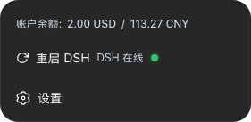

# dsh-footer-order

一个 [DeepSeek Harness](https://github.com/deepseek-ai/deepseek-harness) 的 Web 端插件，解决侧边栏底部(`sidebar.footer.action` 槽位)多个插件内容挤成一行的布局问题，并让你自由配置这些内容的上下排列顺序。

<table align="center">
  <thead>
    <tr><th style="text-align: center">修改前</th><th style="text-align: center">修改后</th></tr>
  </thead>
  <tbody>
    <tr>
      <td align="center"></td>
      <td align="center"></td>
    </tr>
    <tr>
      <td align="center"><sub>多个 footer 插件挤在同一行</sub></td>
      <td align="center"><sub>上下排列，清晰可读</sub></td>
    </tr>
  </tbody>
</table>


> [!NOTE]
> **AI 生成声明**:本插件由 AI 生成，可能存在错误、安全隐患或不符合预期之处，使用前请自行 review 代码并实测：发现任何问题欢迎提交 issue 或 PR 修正。

> [!COMPAT]
> **版本兼容性**：本版本面向 **dsh ≥ 0.2.1-rc.1**，使用 0.2 的配置模型（导出 `Config` schema 由设置缝投影，浏览器侧通过 `ctx.configForms` 读写，设置界面挂在插件自己的页面上）。在 dsh 0.1.x 上请使用 `@choi-p/dsh-footer-order@0.4.x`。

## 问题背景

安装多个插件后，插件会往 `sidebar.footer.action` 槽位写入内容。该槽位的锚点 `div[data-slot="sidebar.footer.action"]` 被 dsh web-react 渲染器加上行内样式 `display: contents`，于是每个条目的根元素直接参与父容器（`.footerActions`，`display: flex`，横向）的布局 —— 多个 footer 插件最终**挤在同一行**。

本插件注入一条 `!important` 样式规则，把锚点改成**纵向 flex 堆叠**（`display: flex; flex-direction: column`），条目即变为**从上到下**排列。

## 功能

- 把 `sidebar.footer.action` 的内容改为纵向堆叠（`display: contents` → flex column），修复挤成一行的布局。
- 可配置条目**上下顺序**：在 bundle 的 `cordis.patch.yml` 行里按从上到下写出条目 id 列表，或在插件配置页用 ↑/↓ 调整。
- 外壳的**设置行**（`settingsArea`，即 `sidebar.settings` 槽位）也参与同一份纵向顺序表：用保留 id `settings` 就能把它放到条目之上、之间或之下；不写它则保持外壳原本的位置（整组 footer 条目下方）。
- **整个 settingsArea 的排列管理**：`settingsLayout`（左右 row、上下 column、反向 row-reverse / column-reverse、不干预 contents）、`settingsGap`（px，默认 8）、`settingsAlign`（center / stretch / start / end），以及 `settingsOrder`（用 ↑/↓ 调整区域内各区块的先后顺序）。作用范围是 `div.settingsArea` **整块容器**，不只是外壳的 `sidebar.settings` 出口：其它插件往这个区域里插入的内容（例如 `@zhengjunyao/dsh-restart` 自己追加的 `.dsh-sidebar-row`）同样是可排列的区块。
- 可配置整体 footer 的 `layout`（column / row / contents）、`gap`（条目间距）、`align`（对齐方式）。
- 兼容**不渲染任何内容的条目**（如 shell 内置的 `cordis-panel`，平时返回 null）：排序自动跳过这类条目，不会因「条目数 ≠ DOM 节点数」而失效。
- 配置热加载 —— 保存立即生效，无需重启 `dsh web`：所有字段都是 volatile，loader 把它当作 live update 处理，不会重挂当前 fiber；编辑 bundle 的 `cordis.patch.yml` base 配置则仍经 patch 层 HMR 重启此 fiber 生效。
- 不注册任何可见的 footer 条目，只做布局与排序，卸载后不留痕迹（样式、DOM 状态与观察器随插件卸载完整清理与还原）。

## 架构

| 端 | 文件 | 作用 |
| --- | --- | --- |
| Host | `lib/index.js` | 导出设置缝投影用的 schemastery `Config`（字段全部 volatile）。不再自建设置命名空间、也不提供 HTTP 代理：配置走 0.2 的设置缝，功能本身全部在客户端 |
| Client | `lib/client.js` | 通过 `ctx.configForms` 读写生效配置；注入覆盖样式（锚点改为纵向 flex，并在配置时接管整个 settingsArea 的排列）；监听 DOM 变化，按配置把锚点下的区块（footer 条目 + 若已列入则含设置行）重新排序，并把 settingsArea 内各区块的顺序写为行内 `order`；注册两个设置界面 |

两个设置界面：

- `plugins.bundle.config`，key 为包名 —— 设置 → 插件中本插件页面上的设置区。
- `plugins.row.config`，key 为 `<包名>#footer-order` —— 插件页为本 bundle 行分发的配置页。

排序实现:每个注册条目在锚点下渲染为**恰好一个子节点**（渲染器按 `order` 升序输出），但部分条目可能渲染为空（如 `cordis-panel`、收起侧边栏时隐藏的读数）。客户端用三层策略把子节点与 `ctx.slots.entriesOfSlot('sidebar.footer.action')` 里的条目 id 配对：① 按条目 `label` 的文本匹配子节点（如「重启 DSH」按钮）；② 沿用此前已确认的配对；③ 对剩余子节点做「配置命中优先、位移最小」的子序列枚举。之后按配置顺序重排 DOM。这样即使存在常驻的空渲染条目，排序也始终生效。

设置行不需要碰外壳那些带哈希后缀的 CSS Module 类名就能定位：`sidebar.settings` 的槽位锚点是 `display: contents`，因此它的**父元素就是 `div.settingsArea`**。当 `order` 里出现保留 id `settings` 时，该区块被移入 footer 列（本插件已拥有的那个锚点）并与条目一起排序；未出现时则把它交还给 `div.footArea` 的最后一个子节点位置 —— 也就是外壳原本渲染它的地方，其余时候完全不碰。插件卸载时同样会还原所有 DOM 与样式，不留痕迹。

`settingsArea` 是外壳与其它插件共用的一块容器（0.2.1 的外壳把它整个交给往里追加内容的一方）：`@zhengjunyao/dsh-restart` 就把自己的 `.dsh-sidebar-row` 作为该区域的最后一个子节点插进来。因此本插件管理的不是 `sidebar.settings` 出口，而是 **`div.settingsArea` 本身**：先给该区块打上稳定的 `data-dfo-settings-area` 标记（它的类名带构建哈希，不能写死），样式规则再针对这个标记生效。

区域里的「区块」由结构化遍历得出：取其**参与布局的元素子节点**，遇到槽位锚点（渲染器给的 `display: contents`，如 `sidebar.settings`）就穿过去 —— 它们的子节点才是真正的 flex item；`position: fixed / absolute` 的浮层（设置面板、onboarding）直接跳过。外壳的设置行按结构识别（内部含 `settings.launcher` 出口或 `aria-haspopup="dialog"` 的触发按钮），固定用保留键 `settings`；其它区块按自身身份取键：`id` → `plugin:<data-plugin>` → `slot:<data-slot>` → 首个类名，因此 dsh-restart 的行就是 `plugin:dsh-sidebar-row`。

区块顺序**只写成行内 `order`（带 `!important`），从不移动 DOM**。原因有两个：flex 先按 CSS `order` 排、再按文档顺序排，行内声明能压过任何外部样式表规则；而 dsh-restart 的观察器只要发现自己的行不是区域的最后一个子节点就会重新追加 —— 一旦这里去搬节点，两边会互相拉锯。清空 `settingsOrder` 时只释放本插件自己写过的 `order`，不会碰插件自有的行内声明。

宽度由同一套规则兜住，不会溢出区域：外壳的设置行原本是 `width: calc(100% + 4px)` 加左右 `-2px` 负边距（贴住侧边栏内边距的一圈「出血」），作为共用一行里的一项时必须改成只占剩下的空间（`flex:1 1 auto; width:auto; margin:0`）；其它插件注入的区块保持自身尺寸（`flex:0 1 auto`），但都带 `min-width:0` 与 `max-width:100%` —— 它们自己的样式表里写着 `width:100%` / `flex:1 1 auto` 时既能把对方挤成 0 宽，也不会把整行顶出区域。

## 安装

### 通过 [plugin-registry](https://github.com/vlln/plugin-registry) 安装

设置 → 插件 → 安装，source 填 `@choi-p/dsh-footer-order` 或 `github:Choi-Peng/dsh-footer-order`。

### 手动安装

```bash
dsh plugin --profile web add "github:Choi-Peng/dsh-footer-order"
```

插件包自带 `cordis.patch.yml`（`package.json` 中的 `dsh.bundle.patch`），安装时由 dsh 自动挂载。重启 `dsh web` 后生效。

### 卸载方式

```bash
dsh plugin --profile web remove @choi-p/dsh-footer-order
```

bundle 挂载随插件移除自动消失；若曾在 profile 层手动写过该行，需先删掉它。

## 配置

插件设置遵循 dsh 0.2 配置模型，**均实时生效，无需重启 `dsh web`**（dsh ≥ 0.2.1-rc.1）：

| 层 | 来源 | 生效方式 |
| --- | --- | --- |
| 默认值 | 导出的 `Config` schema 内置 | — |
| base 层（部署方静态配置） | 插件 bundle 自带 `cordis.patch.yml` 行内 `config`（`dsh.bundle.patch`，安装即自动挂载） | `dsh web` 监听 patch 层（HMR），编辑后自动用新配置重启此 fiber |
| 用户层（运行时设置） | 在插件配置页保存/重置，经设置缝写入 **profile patch 文档**中本插件的配置行；重置 = 清除覆盖值回落 bundle 默认值 | 所有字段 volatile，设置缝发布 live update，立即生效，不重挂 fiber |

base 层 `config`（bundle 默认附带）：

```yaml
- insert:
    - id: footer-order
      name: '@choi-p/dsh-footer-order'
      config:
        layout: column            # column = 纵向堆叠（默认）| row = 横向 | contents = 不干预
        gap: 0                    # 条目间距，px（>= 0）
        align: stretch            # stretch | start | center | end（纵向堆叠时的交叉轴对齐）
        order: []                 # 条目 id 列表；保留 id `settings` = 外壳的设置行(settingsArea)
        settingsLayout: contents  # contents = 不干预（默认）| row | column | row-reverse | column-reverse
        settingsGap: 8            # 区域内各区块的间距，px（默认 8）
        settingsAlign: center     # center | stretch | start | end
        settingsOrder: []         # 区域内区块顺序，如 [settings, plugin:dsh-sidebar-row]
```

> `order` 里的 id 是每个插件向 `sidebar.footer.action` 调用 `slots.register({ name, id, ... })` 时传入的 `id`，不是包名。配置页会列出当前所有已注册 id，可用 ↑/↓ 重新排序。
> `settingsOrder` 里的键是 **settingsArea 内的区块**：`settings` 代表外壳的设置行；其它区块取自身的 `id`，或 `plugin:<data-plugin>`（dsh-restart 的行是 `plugin:dsh-sidebar-row`），取不到时用 `slot:<data-slot>` / 首个类名。未列出的区块保持 DOM 顺序，排在已列出的区块之后；顺序以行内 `order` 应用，不动 DOM。
>
> `settings` 是一个**保留 id**，代表外壳的设置行(`sidebar.settings` 槽位，渲染在 `div.settingsArea` 内)。把它写进 `order` 的任意位置即可 —— 例如 `['settings', 'deepseek-balance']` 让「设置」排在余额之上；不写它，设置行就保持外壳原本的位置：foot 区域底部、整组 footer 条目之下。（若真有 footer 条目注册了 `settings` 这个 id，则以该条目为准 —— 保留 id 只在没有条目占用它时生效。）

配置页采用与官方设置一致的按钮组和输入框风格，分别提供总体 footer 排列管理以及独立的 `settingsArea` 排列管理（覆盖设置行与其它插件注入的区块），并提供 保存 / 恢复默认值。一次保存通过 `ctx.configForms` 作为一个原子写入提交，控制器用命名空间 revision 作栅栏：并发修改会被设置缝拒绝并回读已接受的状态，不会静默覆盖。

## 使用

1. 打开 dsh web —— 侧边栏底部的 footer 条目会上下排列。
2. 设置 → 插件 → **侧边栏底部排序**（bundle 页面或该行的配置页）：调整 layout、gap、对齐方式、上下顺序，以及整个 settingsArea 的排列方向与区块顺序（含 dsh-restart 注入的条目行），然后保存。所有修改实时生效，无需重启 `dsh web`。

## 开发

```bash
pnpm install
node --check lib/index.js
node --check lib/client.js
node scripts/smoke-host.mjs    # host 端:导出的 Config 契约 + 真实 cordis 挂载
node scripts/smoke-client.mjs  # client 端:CSS/排序/配对 + 设置界面 + 表单写入
```

## License

[MIT](./LICENSE)
